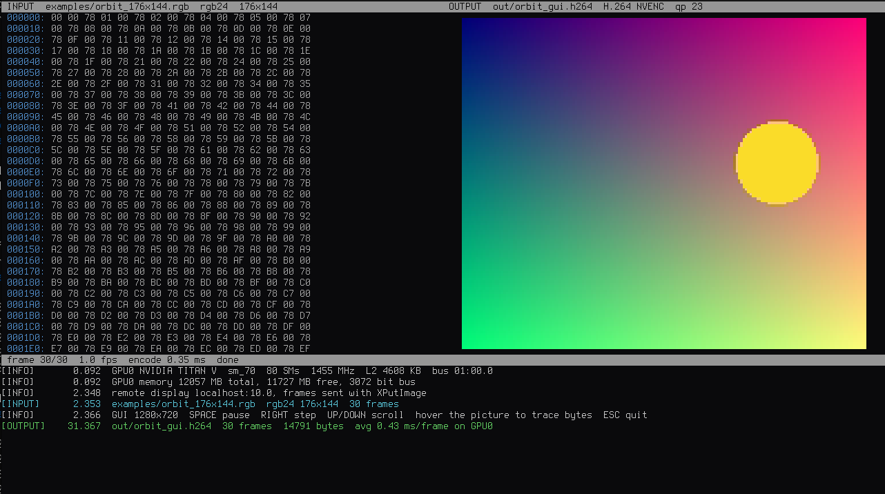
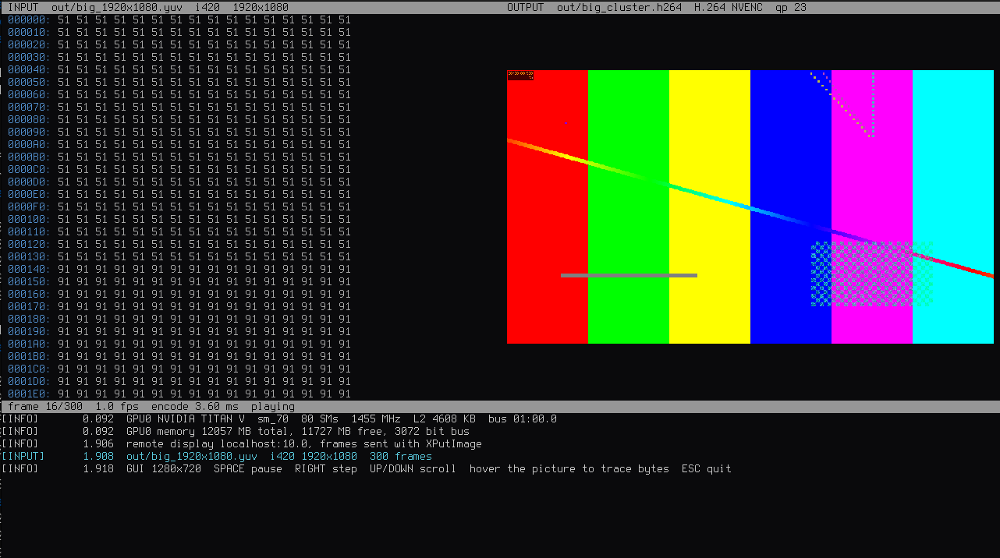

# NVIDIA-VideoEncode
Raw data to H.264 and H.264 back to raw, with the whole pixel path on the GPU.
______________________________________________________________________

| `-gui -enc` rgb24 QCIF clip | `-gui -enc` 1080p I420 clip |
|:---:|:---:|
|  |  |

## Design
```
encode  file -> pinned buffer -> [hex parse] -> to NV12 kernel -> NVENC surface -> H.264
decode  H.264 -> NVDEC -> NV12 -> raw layout kernel -> [hex print] -> file
```
* The CPU only reads and writes files and drives the APIs. Parsing, colour conversion,
  verification and GUI rendering are CUDA kernels.
* The convert kernel writes straight into the NVENC input surface. No staging copy.
* Hex text is parsed on the GPU: flag digits, compact with a CUB select, pack nibbles.
* NVENC and NVDEC produce and consume the bitstream. A CUDA entropy coder can't match the
  fixed function units on speed or conformance, so they are used as is.
* After encoding, the stream is decoded again on NVDEC and compared with the source on the
  GPU. PSNR goes in the log.
* `-cluster` cuts a single file into GOP sized chunks. Each chunk starts with SPS, PPS and
  IDR, and each GPU pulls the next chunk when it is free, so a slower card takes fewer.
  Decoding splits the stream at IDR points the same way. A batch goes one file per GPU.

## Build
CUDA 11+, CMake 3.18, a driver with NVENC/NVDEC. Optional: SDL2 for `-gui`, libx264 for `-benchmark`.
```
sudo apt install cmake libsdl2-dev libx264-dev
./runme.sh -list_devices          # first run configures and builds into build/
ARCH=86 ./runme.sh ...            # other GPU generation (default sm_61, sm_70, sm_75)
```
`runme` is a link to `runme.sh`.

## Usage
```
./runme -enc -i <raw> -o <video.h264>          raw to H.264
./runme -dec -i <video.h264> -o <raw>          H.264 to raw
./runme <in> <out>                             mode from the input extension
./runme -gui -enc -i <raw> -o <video.h264>     input left, output right, log below
./runme -gui -dec -i <video.h264> -o <raw>
./runme -benchmark -i <raw> -o <video.h264>    libx264 on CPU against NVENC, same input
./runme -batch -i a.yuv b.hex -o a.h264 b.h264 pairs in order
./runme -cluster -i <raw> -o <video.h264>      every GPU
./runme -device GPU1 ...                       one GPU, tags from -list_devices
./runme -list_devices
```
| option | meaning |
|---|---|
| `-s WxH` | frame size, else from the y4m header or a name like `clip_640x480.yuv` |
| `-f fmt` | `i420 nv12 gray rgb24 rgba bgra` |
| `-fps N[/D]` | frame rate, default 30 |
| `-qp N` | constant QP, default 23 |
| `-g N` | IDR interval and cluster chunk size, default 2 s |
| `-noverify` | skip the NVDEC check after encoding |

## Formats
| extension | layout |
|---|---|
| `.y4m` | YUV4MPEG2, 4:2:0 or mono, size and rate from the header |
| `.yuv .i420` | planar 4:2:0 |
| `.nv12` | 4:2:0, interleaved chroma |
| `.gray .y` | luma only. `.bin .raw` read as gray, so any data becomes video |
| `.rgb .rgba .bgra` | packed RGB, BT.601 limited range |
| `.hex .txt` | hex bytes as text in the `-f` layout (default i420). Spacing, newlines and `0x` are ignored |
| `.h264 .264` | Annex-B elementary stream |

Decode writes the layout named by the output extension. Hex output is `HH HH ..`, 16 bytes per line.

## GUI
Left pane is the input, right pane the output, log at the bottom. Encode shows the input
bytes in hex and the frame handed to NVENC. Decode shows the decoded frame and the raw
bytes written out. Hover a pixel to highlight its bytes (Y or G white, U or B blue,
V or R red). The status bar shows frame number, rate and time per frame.

`SPACE` pause, `RIGHT` step, `UP DOWN PGUP PGDN` and wheel scroll, `ESC` quit.

The GUI runs on one GPU (`-device`, default GPU0). `-cluster` is ignored with a warning: frames
are shown one by one at playback rate, about 0.3 ms of GPU work per QCIF frame, so a second GPU
would sit idle, and cluster chunks are encoded out of display order.

Over `ssh -X`/`-Y` the display is remote, so GLX and MIT-SHM are not used. Frames go to the
SDL window with plain `XPutImage`, and only when something changed.

## Log
`[INFO] [WARNING] [ERROR] [INPUT] [OUTPUT]` with seconds since start, also written to `<first output>.log`.
A run lists GPU resources, each step, frames and rate per GPU, size, bitrate and PSNR.

## Layout
```
src/kernels.cu     hex parse and print, colour conversion, PSNR, GUI painters
src/convert.h      per 2x2 block conversion, shared by the GPU and the CPU benchmark
src/codec.cpp      NVENC and NVDEC sessions, cluster workers, Annex-B scan
src/source.cpp     input probing and per frame device access
src/gui.cpp        SDL2 front end
src/cpu.cpp        libx264 reference for -benchmark
examples/          QCIF test clips: y4m, rgb24, hex text
Dependencies/      NVIDIA Video Codec SDK 9.0 headers and wrappers
```

## Examples
```
./runme -enc -i examples/bars_176x144.y4m -o bars.h264
./runme -gui -enc -i examples/plasma_176x144.hex -o plasma.h264
./runme -dec -i bars.h264 -o bars_176x144.hex
./runme -benchmark -cluster -i examples/orbit_176x144.rgb -o orbit.h264
```
GUI font: Terminus Font 8x16, SIL Open Font License 1.1, (c) 2010 Dimitar Toshkov Zhekov.

## Note to readers all over the world
I was 18 when I started this project, and about as clueless with version control as I am today.
I made good progress, forgot to commit any of it, and moved on with my life. Then one day the
laptop holding the code decided to part ways with me. The HDD was corrupted beyond repair
(and beyond use, it now makes a decent paperweight).

Recently I recovered what I could from that drive and decided to finish this project once and
for all. Thanks to everyone who forked it and kept working on it. You are the reason I went
digging through a dead hard drive.

Credit to Claude for helping me recover the code, squash some bugs and finally add the features
I had been meaning to add for years :)

Lesson learned: commit early, commit often.

